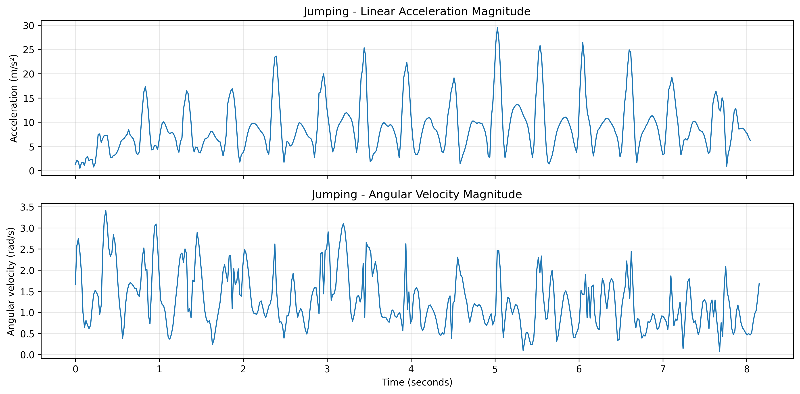
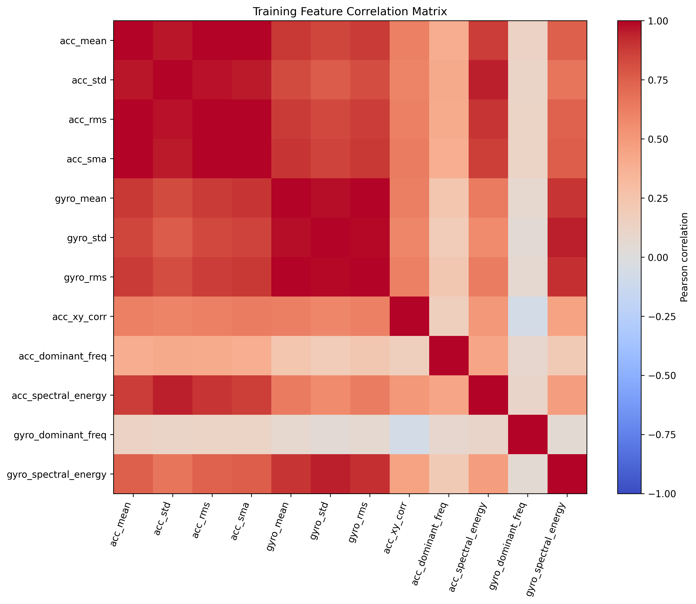
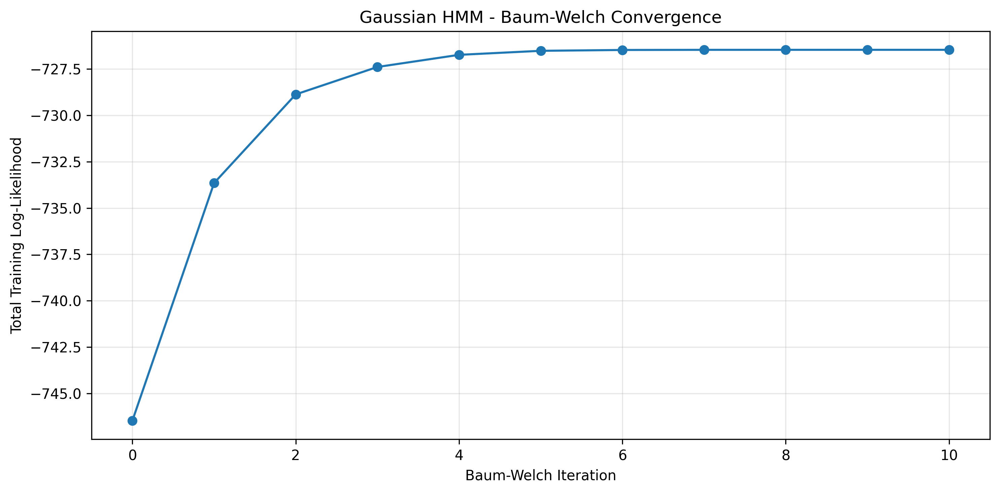
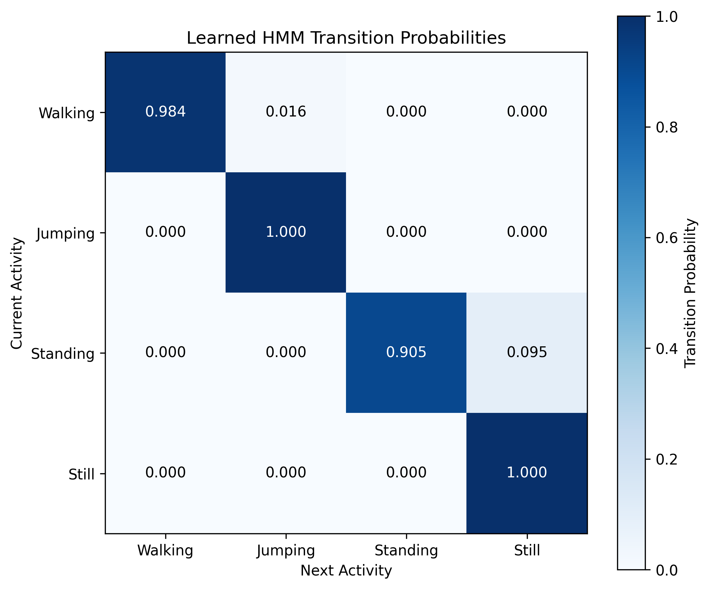
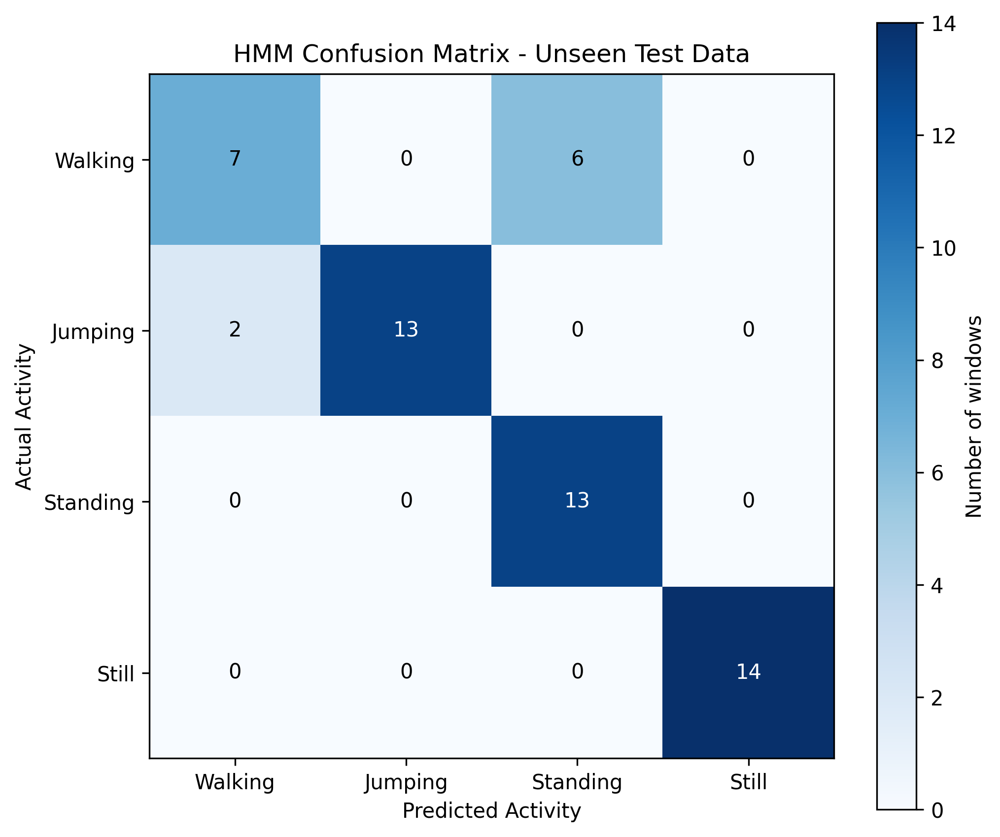
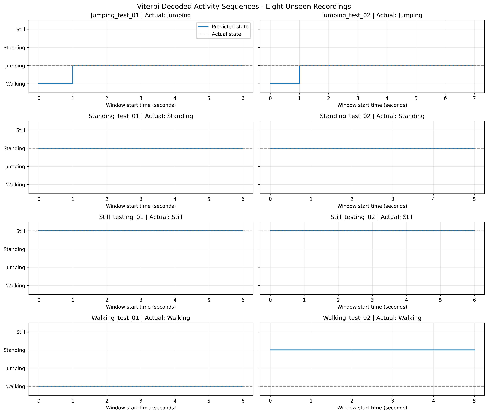
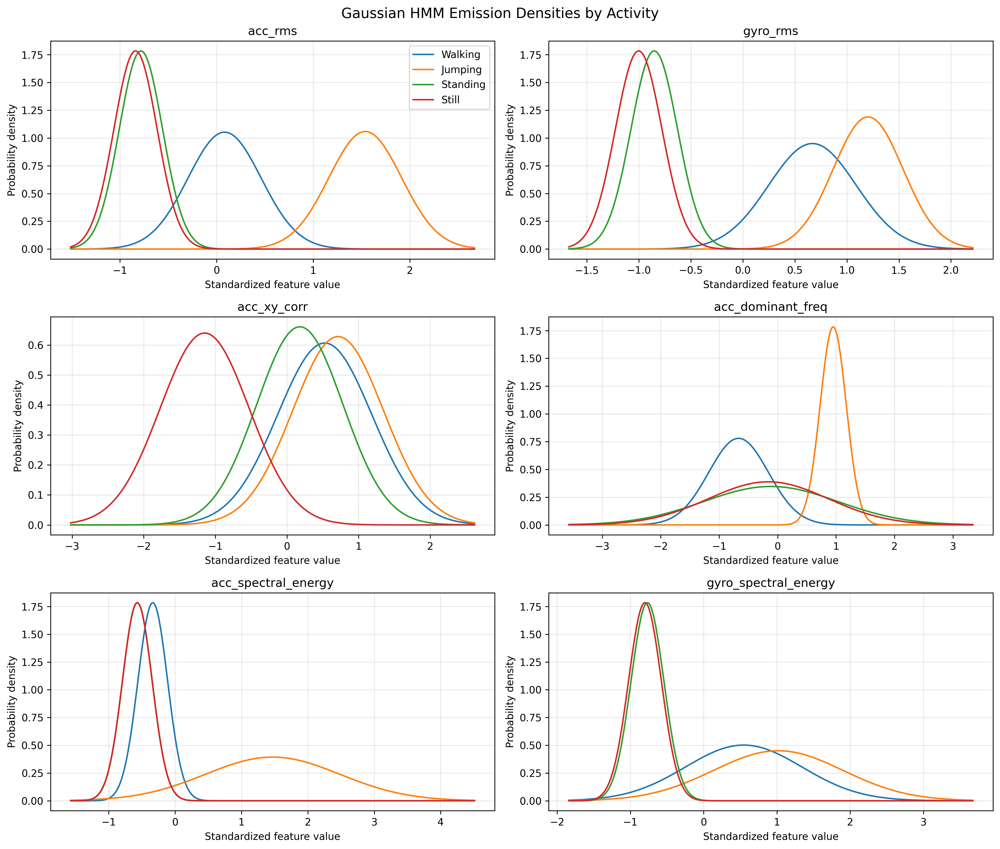

# Human Activity Recognition Using a Gaussian Hidden Markov Model

### Sensor-Based Human Activity Recognition | Machine Learning & Time-Series Analysis

**Author:** Gaddiel Irakoze  
**Institution:** African Leadership University (ALU), Kigali, Rwanda  
**Course:** Machine Learning Techniques II  
**Project:** Formative 2 — Hidden Markov Models  
**Year:** 2026  

---

## 1. Project Overview

This project investigates **Human Activity Recognition (HAR)** using accelerometer and gyroscope measurements collected with a smartphone.

The objective is to identify four physical activity states:

- **Walking**
- **Jumping**
- **Standing**
- **Still (No Movement)**

A four-state Gaussian Hidden Markov Model (HMM) was implemented **from scratch using NumPy**. The model learns the statistical characteristics of sensor observations and uses the Viterbi algorithm to infer the most likely sequence of activities.

The project covers the complete machine learning pipeline, including personal data collection, signal quality assessment, synchronization, filtering, resampling, feature extraction, HMM training, evaluation on unseen recordings, and error analysis.

### Key Results

| Metric | Result |
|---|---:|
| Total sensor recordings | 58 |
| Training recordings | 50 |
| Independent test recordings | 8 |
| Training feature windows | 303 |
| Testing feature windows | 55 |
| Hidden states | 4 |
| Selected features | 6 |
| Baum–Welch iterations | 10 |
| Training window accuracy | 92.74% |
| **Unseen-test window accuracy** | **85.45%** |
| **Unseen-test recording accuracy** | **87.50%** |
| Macro F1-score | 0.8444 |

**Main finding:** The HMM recognized 47 of 55 unseen testing windows and correctly classified seven of eight complete test recordings. Still achieved perfect classification on the available test windows, while Walking was the most challenging activity.

---

## 2. Background and Motivation

Human Activity Recognition involves identifying a person's physical behavior from sensor measurements.

Applications include:

- Physical activity and exercise monitoring.
- Smart wearable systems.
- Mobility and movement analysis.
- Human-centered Internet of Things (IoT) applications.
- Context-aware mobile applications.

Many activity recognition approaches can benefit from cameras, sophisticated wearable devices, or substantial computational resources.

However, smartphone accelerometers and gyroscopes provide a relatively inexpensive alternative for investigating human movement patterns.

### Project Use Case

The proposed application is a **lightweight, smartphone-based activity recognition system** capable of identifying walking, jumping, standing, and inactivity from motion signals.

Such a system could support offline mobility and exercise tracking in environments where specialized sensing equipment, reliable connectivity, or computational infrastructure may be limited.

This project is a proof of concept and has not been deployed as a medical, health-monitoring, or safety-critical system.

### Research Question

> Can a Gaussian Hidden Markov Model, using engineered time-domain and frequency-domain features from smartphone sensors, reliably distinguish four human activity states on previously unseen recordings?

---

## 3. Dataset Collection

### 3.1 Data Source

The dataset was collected personally using a smartphone sensor-logging application.

Two motion sensors were used:

**Linear accelerometer**

Measures gravity-compensated linear acceleration along three axes:

- `acc_x`
- `acc_y`
- `acc_z`

Unit: meters per second squared (m/s²).

**Gyroscope**

Measures angular velocity along three axes:

- `gyro_x`
- `gyro_y`
- `gyro_z`

Unit: radians per second (rad/s).

Both sensor streams originally contained timestamps used to align measurements during preprocessing.

### 3.2 Activity Collection Protocol

Four activities were recorded under the following conditions:

| Activity | Recording Procedure |
|---|---|
| Walking | Walk at a consistent pace while carrying the smartphone |
| Jumping | Perform repeated jumps while carrying the smartphone |
| Standing | Remain standing while holding the phone steadily near waist level |
| Still | Place the smartphone on a flat surface without intentional movement |

Each independent recording lasted approximately 5–10 seconds.

The original sensor recordings were preserved as ZIP archives, containing timestamped sensor CSV files.

### 3.3 Dataset Distribution

| Activity | Training Recordings | Test Recordings | Usable Training Duration |
|---|---:|---:|---:|
| Walking | 13 | 2 | 94.48 s |
| Jumping | 12 | 2 | 93.96 s |
| Standing | 12 | 2 | 93.80 s |
| Still | 13 | 2 | 97.16 s |
| **Total** | **50** | **8** | **379.40 s** |

The dataset includes at least 90 seconds of usable training data for each activity.

The eight test recordings were reserved for final evaluation and were not used to fit the normalization parameters or train the HMM.

### 3.4 Data Collection Video Evidence

Four short videos document the activity collection procedures.

**[View all four data collection videos on Google Drive](https://drive.google.com/drive/folders/17YPcBk_a7-3nDLnKP6GXnCP-e8ZgXAr9?usp=sharing)**

The folder contains:

1. `Walking.mp4`
2. `Jumping.mp4`
3. `Standing.mp4`
4. `Steady_phone_on_flat_surface.mp4`

The videos are stored separately from the GitHub repository to avoid including large personal video files in the source-code distribution.

---

## 4. Data Quality Assessment

Before preprocessing, the original recordings were audited to identify potential problems with sensor data quality.

The checks included:

- Presence of accelerometer and gyroscope readings.
- Valid timestamps and chronological ordering.
- Missing and non-finite sensor values.
- Repeated or invalid timestamps.
- Unusually large timestamp gaps.
- Recording duration and sensor overlap.
- Duplicate recordings.

The automated quality assessment found no missing or infinite readings, invalid or duplicated timestamps, gaps exceeding 100 milliseconds, or duplicated sensor recordings across the 58 files.

The original archives were kept unchanged, and processed sensor measurements were saved separately.

This separation preserves the original evidence and makes preprocessing easier to inspect.

---

## 5. Signal Preprocessing

### 5.1 Sampling Rate Differences

The original sensor streams did not always use identical sampling rates.

Observed frequencies included:

| Sensor | Observed Sampling Frequencies |
|---|---|
| Accelerometer | Approximately 27.55 Hz or 55.10 Hz |
| Gyroscope | Approximately 55.10 Hz |

These differences required synchronization and resampling before feature extraction.

### 5.2 Filtering and Synchronization

The preprocessing pipeline performed the following operations:

1. Extract accelerometer and gyroscope data from each original recording.
2. Identify the overlapping timestamp interval between the two sensors.
3. Apply a sixth-order Butterworth low-pass filter with an 8 Hz cutoff.
4. Use zero-phase forward-backward filtering to reduce phase distortion.
5. Interpolate both filtered signals onto a common sampling grid.
6. Resample the synchronized signals to 25 Hz.
7. Save the resulting measurements as structured CSV files.

The target sampling interval is:

\[
\Delta t = \frac{1}{25} = 0.04 \text{ seconds}
\]

The 25 Hz rate was selected to provide consistent observation timing while preserving the lower-frequency motion patterns relevant to the activity recognition task.

### 5.3 Processed Dataset Format

Each processed CSV contains:

| Column | Description |
|---|---|
| `time_s` | Elapsed time in seconds |
| `acc_x` | Linear acceleration, X-axis |
| `acc_y` | Linear acceleration, Y-axis |
| `acc_z` | Linear acceleration, Z-axis |
| `gyro_x` | Angular velocity, X-axis |
| `gyro_y` | Angular velocity, Y-axis |
| `gyro_z` | Angular velocity, Z-axis |

All 58 synchronized recordings are available under [`data/processed/`](data/processed/).

The corresponding metadata is stored in [`recordings_manifest.csv`](data/processed/recordings_manifest.csv).

### Example Raw Sensor Signals



*Figure 1. Representative acceleration and angular-velocity magnitude signals during Jumping.*

---

## 6. Window Segmentation

The continuous sensor streams were divided into fixed-length windows to create HMM observations.

### Selected Window Parameters

| Parameter | Value |
|---|---:|
| Sampling frequency | 25 Hz |
| Window duration | 2 seconds |
| Samples per window | 50 |
| Window overlap | 50% |
| Hop size | 25 samples |
| Hop duration | 1 second |
| FFT frequency resolution | 0.5 Hz |

The number of samples per window is:

\[
N = f_s T = 25 \times 2 = 50
\]

The FFT frequency-bin spacing is:

\[
\Delta f = \frac{f_s}{N} = \frac{25}{50} = 0.5 \text{ Hz}
\]

### Justification

Two-second windows provide enough samples to extract useful statistical and frequency-domain characteristics while retaining relatively fine temporal resolution.

The 50% overlap generates one new observation each second and reduces the likelihood that short-term movement patterns fall entirely between adjacent windows.

Each recording was segmented independently. Windows were never constructed across the boundaries of separate recordings.

Only complete windows were retained.

### Generated Observations

| Dataset | Feature Windows |
|---|---:|
| Training | 303 |
| Testing | 55 |
| **Total** | **358** |

These window-level observations form the inputs to the HMM.

---

## 7. Feature Engineering

Two categories of features were extracted from the synchronized motion signals:

- **Time-domain features**, describing the statistical characteristics of movement.
- **Frequency-domain features**, describing oscillations, rhythm, and spectral energy.

### 7.1 Time-Domain Features

The initial feature engineering process included:

| Feature | Description |
|---|---|
| `acc_mean` | Mean acceleration magnitude |
| `acc_std` | Standard deviation of acceleration magnitude |
| `acc_rms` | Root mean square of acceleration magnitude |
| `acc_sma` | Signal magnitude area from acceleration axes |
| `gyro_mean` | Mean gyroscope magnitude |
| `gyro_std` | Standard deviation of gyroscope magnitude |
| `gyro_rms` | Root mean square of gyroscope magnitude |
| `acc_xy_corr` | Correlation between X and Y acceleration components |

Root mean square (RMS) summarizes the intensity of movement:

\[
RMS = \sqrt{\frac{1}{N}\sum_{i=1}^{N}x_i^2}
\]

Acceleration RMS and gyroscope RMS help distinguish activities involving stronger translational or rotational motion from relatively stationary activities.

### 7.2 Frequency-Domain Features

The following FFT-derived features were calculated:

| Feature | Description |
|---|---|
| `acc_dominant_freq` | Dominant nonzero acceleration frequency |
| `acc_spectral_energy` | Acceleration spectral energy in the selected frequency band |
| `gyro_dominant_freq` | Dominant nonzero gyroscope frequency |
| `gyro_spectral_energy` | Gyroscope spectral energy in the selected frequency band |

The Fast Fourier Transform was used after subtracting each signal's mean.

Spectral energy was computed using normalized one-sided power over the 0.5–8 Hz frequency range.

These features help capture repetitive activity patterns and the intensity of movement fluctuations.

### 7.3 Feature Correlation Analysis

Twelve candidate numerical features were initially extracted.

A correlation analysis on the training data identified substantial redundancy among several features.

For example, acceleration mean and acceleration RMS were correlated at approximately 0.999.

Retaining highly redundant observations may complicate interpretation and can be problematic for a Gaussian HMM with diagonal covariance assumptions.

Consequently, a smaller feature subset was selected.



*Figure 2. Correlation structure of the engineered training features.*

### 7.4 Final Selected Features

The following six features were used to train the HMM:

| Feature | Domain | Main Contribution |
|---|---|---|
| `acc_rms` | Time | Translational movement intensity |
| `gyro_rms` | Time | Rotational movement intensity |
| `acc_xy_corr` | Time | Relationships between movement axes |
| `acc_dominant_freq` | Frequency | Repetitive movement rhythm |
| `acc_spectral_energy` | Frequency | Acceleration fluctuation energy |
| `gyro_spectral_energy` | Frequency | Rotational fluctuation energy |

The complete twelve-feature datasets are available in:

- [`train_features.csv`](data/features/train_features.csv)
- [`test_features.csv`](data/features/test_features.csv)

The selected features and window parameters are also recorded in [`feature_selection.json`](data/features/feature_selection.json).

### 7.5 Feature Standardization

A `StandardScaler` was fitted using the training feature windows only.

For feature value \(x\):

\[
z = \frac{x-\mu_{train}}{\sigma_{train}}
\]

The same training-fitted transformation was applied to the unseen test windows.

This prevents information from the test distribution from influencing model fitting.

---

## 8. Hidden Markov Model Architecture

The project uses a **four-state Gaussian Hidden Markov Model with diagonal covariance matrices**.

### 8.1 Hidden States

The hidden state space is:

\[
Z = \{\text{Walking},\text{Jumping},\text{Standing},\text{Still}\}
\]

Each hidden state represents one physical activity.

### 8.2 Observations

Each observation is a standardized six-dimensional feature vector extracted from a two-second sensor window.

\[
X_t \in \mathbb{R}^{6}
\]

An individual recording produces a chronological sequence of feature vectors.

### 8.3 HMM Parameters

The model includes three principal components:

**Initial-state distribution**

\[
\pi_i = P(Z_1=i)
\]

**Transition matrix**

\[
A_{ij} = P(Z_{t+1}=j \mid Z_t=i)
\]

**Gaussian emission distributions**

\[
P(X_t=x\mid Z_t=k)
=
\mathcal{N}(x;\mu_k,\operatorname{diag}(\sigma_k^2))
\]

Each activity state has its own mean vector and diagonal covariance matrix.

### 8.4 Model Initialization

The HMM was initialized using:

| Parameter | Initialization |
|---|---|
| Hidden states | 4 |
| Observation dimensions | 6 |
| Initial-state probabilities | Uniform |
| Initial self-transition probabilities | 0.98 |
| Initial off-diagonal transition probabilities | Equal share of remaining 0.02 |
| Gaussian means and variances | Initialized using labelled training windows |
| Minimum variance | 0.05 |
| Maximum Baum–Welch iterations | 150 |
| Convergence tolerance | 0.0001 |

The class-informed Gaussian initialization helps align the hidden states with the four known activities.

Baum–Welch subsequently updates the parameters using the training observation sequences.

### 8.5 Algorithms Implemented

The implementation includes:

**Forward–Backward algorithm**

Computes posterior state probabilities and expected transitions for each training sequence.

**Baum–Welch algorithm**

Uses Expectation–Maximization to iteratively update the HMM parameters and maximize the observed-data likelihood.

**Viterbi algorithm**

Finds the highest-scoring hidden-state sequence for a given series of sensor observations.

All three algorithms were implemented from scratch using **NumPy**, including log-space probability computations for improved numerical stability.

The project does **not** use `hmmlearn` to implement the HMM.

---

## 9. Model Training and Convergence

The model was trained using 50 independent training recordings containing 303 observation windows.

Each recording was treated as a separate sequence to avoid creating artificial transitions between unrelated recording sessions.

### Training Results

| Metric | Result |
|---|---:|
| Training sequences | 50 |
| Training windows | 303 |
| Initial total log-likelihood | −746.4748 |
| Final total log-likelihood | −726.4631 |
| Log-likelihood improvement | +20.0117 |
| Final log-likelihood change | 0.00002714 |
| Baum–Welch iterations | 10 |
| Converged | Yes |
| Training window accuracy | 92.74% |

The Baum–Welch algorithm converged after ten iterations.

The final absolute change in total log-likelihood was below the convergence threshold of \(10^{-4}\).



*Figure 3. Baum–Welch training log-likelihood across iterations.*

The log-likelihood increased during training before stabilizing.

Convergence demonstrates that the optimization procedure reached its stopping criterion under the chosen initialization. It does not establish that the model found a global optimum.

### Learned Transition Probabilities



*Figure 4. Learned HMM state-transition probabilities.*

The learned transition matrix was dominated by self-transitions.

Approximate self-transition probabilities were:

| State | Probability of Remaining in State |
|---|---:|
| Walking | 0.9843 |
| Jumping | ≈ 1.0000 |
| Standing | 0.9050 |
| Still | ≈ 1.0000 |

The largest noticeable off-diagonal terms were:

- Walking → Jumping: 0.0157
- Standing → Still: 0.0950

These values describe the fitted model, not verified real-world transition frequencies.

Because each original recording contained one sustained activity, genuine transitions between different physical activities were not directly observed during collection.

---

## 10. Evaluation on Unseen Test Data

The trained HMM was evaluated using eight held-out recordings, with two recordings for each activity.

The test recordings were not used to update the model parameters.

The Viterbi algorithm generated a predicted hidden-state sequence for each recording.

Two levels of evaluation were used:

- **Window-level evaluation:** Comparison of individual decoded windows with the true activity label.
- **Recording-level evaluation:** Classification of the complete recording using the majority of its decoded state labels.

### 10.1 Overall Results

| Evaluation Metric | Result |
|---|---:|
| Test recordings | 8 |
| Test windows | 55 |
| Correctly classified windows | 47 |
| Incorrectly classified windows | 8 |
| Window-level accuracy | 85.45% |
| Recording-level accuracy | 87.50% |
| Macro F1-score | 0.8444 |
| Weighted F1-score | 0.8503 |

Window-level accuracy:

\[
Accuracy_{window} = \frac{47}{55}\times100 = 85.45\%
\]

Recording-level accuracy:

\[
Accuracy_{recording} = \frac{7}{8}\times100 = 87.50\%
\]

The difference between training-window accuracy and testing-window accuracy was approximately **7.29 percentage points**.

This suggests some loss of generalization, although the independent test dataset was relatively small.

### 10.2 Confusion Matrix



*Figure 5. Confusion matrix generated from the 55 unseen test windows.*

Numerical confusion matrix:

| Actual / Predicted | Walking | Jumping | Standing | Still |
|---|---:|---:|---:|---:|
| Walking | 7 | 0 | 6 | 0 |
| Jumping | 2 | 13 | 0 | 0 |
| Standing | 0 | 0 | 13 | 0 |
| Still | 0 | 0 | 0 | 14 |

The eight incorrect predictions consisted of:

- Six Walking windows incorrectly classified as Standing.
- Two Jumping windows incorrectly classified as Walking.

All Standing and Still test windows were correctly identified.

### 10.3 Sensitivity and Specificity

Sensitivity measures the proportion of actual examples of an activity correctly identified.

\[
Sensitivity = \frac{TP}{TP+FN}
\]

Specificity measures the proportion of observations from other activities correctly rejected.

\[
Specificity = \frac{TN}{TN+FP}
\]

The class-specific results were:

| Activity | Test Windows | Sensitivity | Specificity | One-vs-Rest Accuracy |
|---|---:|---:|---:|---:|
| Walking | 13 | 53.85% | 95.24% | 85.45% |
| Jumping | 15 | 86.67% | 100.00% | 96.36% |
| Standing | 13 | 100.00% | 85.71% | 89.09% |
| Still | 14 | 100.00% | 100.00% | 100.00% |

The one-vs-rest accuracy values are calculated separately for each activity. The overall four-class test-window accuracy remains **85.45%**.

### 10.4 Viterbi Decoded Sequences



*Figure 6. Predicted hidden-state sequences for all eight unseen recordings.*

The plots show that:

- Both Jumping recordings were initially predicted as Walking for their first window, then correctly identified as Jumping.
- Both Standing recordings were classified correctly across all windows.
- Both Still recordings were classified correctly across all windows.
- `Walking_test_01` was correctly classified throughout.
- `Walking_test_02` was incorrectly classified as Standing throughout.

This indicates that the HMM generally produced stable activity predictions, but some recordings could be persistently assigned to an incorrect hidden state.

---

## 11. Gaussian Emission Analysis

The fitted Gaussian emission distributions describe the likelihood of observing particular feature values under each activity state.



*Figure 7. State-conditional Gaussian emission densities for the six selected features.*

The emission plots suggest that:

**Acceleration RMS**

Helps separate intensive motion such as Jumping and Walking from lower-intensity states such as Standing and Still.

**Gyroscope RMS**

Provides rotational-motion information, helping distinguish active movement from relative inactivity.

**Acceleration X–Y Correlation**

Provides complementary information about relationships between sensor axes and helps differentiate some stationary patterns.

**Acceleration Dominant Frequency**

Captures rhythmic differences in movement, particularly between Walking and Jumping.

**Acceleration and Gyroscope Spectral Energy**

Describe the intensity of fluctuations across the selected frequency band.

No single feature perfectly separates every activity.

The HMM combines multiple feature distributions and temporal information to estimate the most likely hidden-state sequence.

---

## 12. Investigation of Walking Misclassification

The most significant evaluation error occurred in `Walking_test_02`.

Although the recording contained Walking activity, the HMM predicted Standing for all six observation windows.

To investigate this error, a post-evaluation diagnostic compared the fitted Gaussian emission log-densities for Walking and Standing.

### Diagnostic Comparison

| Quantity | Walking_test_01 | Walking_test_02 |
|---|---:|---:|
| Number of windows | 7 | 6 |
| Predicted activity | Walking | Standing |
| Standing-minus-Walking emission advantage | −138.3795 | +4.6548 |
| Initial/transition advantage | −0.5721 | −0.4881 |
| Complete constant-path advantage | −138.9515 | +4.1666 |

Negative values favor Walking, whereas positive values favor Standing.

For `Walking_test_02`, the overall emission evidence favored Standing.

### Most Influential Features

| Feature | Average Standing-minus-Walking Log-Density Difference |
|---|---:|
| Acceleration dominant frequency | +5.7283 |
| Acceleration X–Y correlation | +0.7691 |
| Acceleration spectral energy | +0.2639 |
| Gyroscope spectral energy | +0.1941 |
| Acceleration RMS | −2.7758 |
| Gyroscope RMS | −3.4038 |

The acceleration dominant-frequency feature provided the strongest evidence in favor of Standing.

Although acceleration RMS and gyroscope RMS favored Walking, their contributions were insufficient to overcome the combined evidence favoring Standing.

The initial-state and self-transition component slightly favored Walking rather than Standing.

Therefore, the error was primarily associated with the **Gaussian emission evidence**, rather than a stronger transition prior for Standing.

This analysis was conducted after the final evaluation. **No model parameters were modified using the held-out test results.**

Diagnostic CSV files are available in the [`models/`](models/) directory.

---

## 13. Repository Structure

```text
Human-Motion-Recognition_HMM/
│
├── README.md
│
├── Human_Activity_Recognition_HMM_Report.docx.pdf
│
├── data/
│   ├── processed/
│   │   ├── Walking/
│   │   │   ├── Train/
│   │   │   └── Test/
│   │   ├── Jumping/
│   │   │   ├── Train/
│   │   │   └── Test/
│   │   ├── Standing/
│   │   │   ├── Train/
│   │   │   └── Test/
│   │   ├── Still/
│   │   │   ├── Train/
│   │   │   └── Test/
│   │   └── recordings_manifest.csv
│   │
│   └── features/
│       ├── train_features.csv
│       ├── test_features.csv
│       └── feature_selection.json
│
├── notebooks/
│   ├── 01_data_preprocessing.ipynb
│   ├── 02_feature_extraction.ipynb
│   └── 03_hmm_modeling.ipynb
│
├── models/
│   ├── gaussian_hmm_4state.npz
│   ├── test_activity_metrics.csv
│   ├── test_recording_predictions.csv
│   ├── walking_feature_comparison.csv
│   └── walking_feature_contributions.csv
│
└── figures/
    ├── Feature_Correlation_Heatmap.png
    ├── HMM_Baum_Welch_Convergence.png
    ├── HMM_Gaussian_Emission_Densities.png
    ├── HMM_Test_Confusion_Matrix.png
    ├── HMM_Transition_Matrix.png
    ├── HMM_Viterbi_Test_Sequences.png
    ├── Walking_Sensor_Signals.png
    ├── Jumping_Sensor_Signals.png
    ├── Standing_Sensor_Signals.png
    └── Still_Sensor_Signals.png
```

### Notebook Descriptions

| Notebook | Purpose |
|---|---|
| `01_data_preprocessing.ipynb` | Raw-data inspection, quality validation, filtering, synchronization, resampling, and saving processed recordings |
| `02_feature_extraction.ipynb` | Window segmentation, time-domain and FFT feature extraction, feature correlation analysis, and feature selection |
| `03_hmm_modeling.ipynb` | HMM implementation, Baum–Welch training, Viterbi decoding, unseen-data evaluation, visualization, and misclassification analysis |

---

## 14. Running and Reproducing the Project

### Technologies Used

- Python
- NumPy
- pandas
- SciPy
- Matplotlib
- scikit-learn
- Google Colab
- Jupyter Notebook
- Google Drive

The HMM itself was implemented with NumPy. Scikit-learn was used for feature standardization and evaluation metrics.

### 14.1 Clone the Repository

```bash
git clone https://github.com/Gaddy01/Human-Motion-Recognition_HMM.git
cd Human-Motion-Recognition_HMM
```

### 14.2 Install Dependencies

In a Python environment:

```bash
pip install numpy pandas scipy matplotlib scikit-learn jupyter
```

Google Colab already includes many of these packages.

### 14.3 Open the Notebooks

The notebooks can be opened directly using Google Colab:

**[Notebook 1 — Data Preprocessing](https://colab.research.google.com/github/Gaddy01/Human-Motion-Recognition_HMM/blob/main/notebooks/01_data_preprocessing.ipynb)**

**[Notebook 2 — Feature Extraction](https://colab.research.google.com/github/Gaddy01/Human-Motion-Recognition_HMM/blob/main/notebooks/02_feature_extraction.ipynb)**

**[Notebook 3 — HMM Modeling](https://colab.research.google.com/github/Gaddy01/Human-Motion-Recognition_HMM/blob/main/notebooks/03_hmm_modeling.ipynb)**

### 14.4 Important Google Drive Path Configuration

The notebooks were originally developed in Google Colab using the author's personal Google Drive directory:

```text
/content/drive/MyDrive/Formative2 HMM/
```

They refer to the following folders:

```text
Formative2 HMM/
├── Raw Collected Data/
├── Processed Data/
├── Features/
├── Models/
└── Plots/
```

These paths are not identical to the public GitHub folder structure.

Consequently, a fresh clone does **not** execute all notebooks automatically without adjusting file paths or preparing the expected Drive directories.

To reproduce the feature extraction and modeling stages in Colab, a reader can clone the repository and copy the public processed data into the folder structure expected by the notebooks:

```python
from google.colab import drive
from pathlib import Path
import subprocess
import shutil

drive.mount("/content/drive")

repo = Path("/content/hmm_repo")
project = Path("/content/drive/MyDrive/Formative2 HMM")

subprocess.run([
    "git", "clone",
    "https://github.com/Gaddy01/Human-Motion-Recognition_HMM.git",
    str(repo)
], check=True)

project.mkdir(parents=True, exist_ok=True)

folder_mapping = {
    "data/processed": "Processed Data",
    "data/features": "Features",
    "models": "Models",
    "figures": "Plots"
}

for source, destination in folder_mapping.items():
    shutil.copytree(
        repo / source,
        project / destination,
        dirs_exist_ok=True
    )

print("Project files prepared successfully.")
```

The notebooks can then be executed in this order:

1. `02_feature_extraction.ipynb`
2. `03_hmm_modeling.ipynb`

Alternatively, the modeling notebook can be run directly using the supplied feature CSVs and configuration file.

**Important:** The first preprocessing notebook requires the original raw sensor ZIP archives, which are preserved separately and are not distributed in this GitHub repository. The processed CSV recordings are included and support reproduction of the later feature extraction and HMM modeling stages.

---

## 15. Saved Model and Evaluation Artifacts

The trained model is stored in:

[`models/gaussian_hmm_4state.npz`](models/gaussian_hmm_4state.npz)

The NumPy archive contains:

- Initial-state probabilities (`pi`)
- Transition matrix (`A`)
- Gaussian means (`means`)
- Gaussian variances (`variances`)
- Activity labels
- Selected feature names
- Training-fitted standardization statistics
- Baum–Welch log-likelihood history

Additional evaluation artifacts include:

| File | Content |
|---|---|
| `test_activity_metrics.csv` | Class-specific sensitivity, specificity, and one-vs-rest accuracy |
| `test_recording_predictions.csv` | Actual and predicted activities for each test recording |
| `walking_feature_comparison.csv` | Standardized feature comparison for Walking test recordings |
| `walking_feature_contributions.csv` | Feature-specific Gaussian log-density evidence |

These files allow readers to inspect the trained parameters and evaluation outcomes without repeating the full training procedure.

---

## 16. Limitations

Several limitations should be considered when interpreting the results.

### Limited Dataset Size

Only eight independent recordings were available for testing, with two recordings per activity.

Therefore, the reported accuracy estimates may not represent performance across broader populations or recording conditions.

### Single-Participant Collection

The dataset was collected by one participant using one smartphone.

Performance across different participants, devices, movement styles, and phone placements has not been established.

### Overlapping Feature Windows

The 50% window overlap creates correlated observations.

The 55 testing windows are therefore not equivalent to 55 statistically independent test recordings.

### Limited Real Activity Transitions

Each recording contains one sustained activity.

The learned transition probabilities mainly describe persistence within these recordings.

The model has not been comprehensively validated on continuous recordings containing genuine changes between activities.

### Gaussian Emission Assumptions

The model uses diagonal Gaussian covariance matrices.

These assumptions may not fully represent complex or correlated feature distributions.

### Sensitivity to Movement Characteristics

The misclassification of `Walking_test_02` demonstrates that differences in frequency characteristics and rotational intensity can substantially affect model predictions.

---

## 17. Future Improvements

Potential future directions include:

1. Collecting additional recordings across multiple participants and sessions.
2. Evaluating different smartphone placements and orientations.
3. Recording continuous sequences containing genuine transitions between activities.
4. Testing alternative window durations and overlap settings.
5. Investigating additional frequency-domain and orientation-robust features.
6. Comparing diagonal Gaussian emissions with more flexible emission models.
7. Performing recording-level cross-validation using training recordings.
8. Evaluating robustness under different noise and sampling conditions.
9. Exploring lightweight, on-device inference for practical mobile applications.

Any feature or model selection should be carried out using training-only validation rather than repeatedly tuning against the held-out test set.

---

## 18. Academic Report

The full five-page academic report covers the background, data collection, preprocessing, feature engineering, HMM implementation, training results, unseen-data evaluation, error analysis, discussion, and conclusion.

**[Read the Complete Academic Report (PDF)](Human_Activity_Recognition_HMM_Report.docx.pdf)**

The report was prepared for the Formative 2 Hidden Markov Models assessment in Machine Learning Techniques II at African Leadership University.

---

## 19. Responsible Use and AI Disclosure

AI tools were used to assist with code debugging, interpretation of selected results, and report drafting.

The author maintains responsibility for the submitted work and can independently explain and justify the methodology, algorithms, implementation, and findings.

The project is intended for educational and research purposes. The current results should not be interpreted as establishing reliability for clinical diagnosis, safety monitoring, or other high-stakes applications.

---

## 20. Author

**Gaddiel Irakoze**  
Bachelor of Software Engineering  
African Leadership University — Kigali, Rwanda

**GitHub:** [Gaddy01](https://github.com/Gaddy01)

**Repository:** [Human-Motion-Recognition_HMM](https://github.com/Gaddy01/Human-Motion-Recognition_HMM)

---

## Conclusion

This project demonstrates an end-to-end approach to smartphone-based Human Activity Recognition using a Gaussian Hidden Markov Model implemented from scratch.

By combining synchronized accelerometer and gyroscope signals, carefully engineered features, Baum–Welch parameter estimation, and Viterbi sequence decoding, the model achieved **85.45% accuracy on unseen testing windows** and **87.50% accuracy at the recording level**.

The results demonstrate the potential of lightweight sensor-based activity recognition while highlighting the challenges associated with limited training data, overlapping activity characteristics, and unobserved transitions between physical activities.

